<a href="https://www.lucassr.dev">
  <picture>
    <source media="(prefers-color-scheme: dark)" srcset="https://raw.githubusercontent.com/lucassr-dev/lucassr-dev/output/hero-dark.svg">
    
  </picture>
</a>

  <a href="https://www.lucassr.dev"><b>lucassr.dev</b></a> ·
  <a href="https://linkedin.com/in/lucassrjob">LinkedIn</a> ·
  <a href="https://github.com/lucassrdev-humu">perfil de trabalho</a>

### Sobre

- Desenvolvedor front-end na **Humu** desde maio de 2026, atuando também no back-end em produtos de **crédito digital e banking**: React e TypeScript na interface, Laravel na API, testes com Playwright e Vitest.
- Fora do expediente construo o **BrutusForge**, uma plataforma completa para comunidades de servidores de jogo.
- Gosto de ferramenta bem afiada: meus **dotfiles** montam uma máquina de desenvolvimento inteira em Linux, macOS e Windows com um comando.
- Formado em Análise e Desenvolvimento de Sistemas pela Estácio (2023).

### Atividade

<picture>
    <source media="(prefers-color-scheme: dark)" srcset="https://raw.githubusercontent.com/lucassr-dev/lucassr-dev/output/stats-dark.svg">
    
  </picture>

<picture>
    <source media="(prefers-color-scheme: dark)" srcset="https://raw.githubusercontent.com/lucassr-dev/lucassr-dev/output/activity-dark.svg">
    
  </picture>

### Projetos

<a href="https://github.com/lucassr-dev/brutusforge-releases">
  <picture>
    <source media="(prefers-color-scheme: dark)" srcset="https://raw.githubusercontent.com/lucassr-dev/lucassr-dev/output/card-brutusforge-dark.svg">
    
  </picture>
</a>

<a href="https://github.com/lucassr-dev/dotfiles">
  <picture>
    <source media="(prefers-color-scheme: dark)" srcset="https://raw.githubusercontent.com/lucassr-dev/lucassr-dev/output/card-dotfiles-dark.svg">
    
  </picture>
</a>
<a href="https://www.lucassr.dev">
  <picture>
    <source media="(prefers-color-scheme: dark)" srcset="https://raw.githubusercontent.com/lucassr-dev/lucassr-dev/output/card-site-dark.svg">
    
  </picture>
</a>

### Stack

<picture>
    <source media="(prefers-color-scheme: dark)" srcset="https://raw.githubusercontent.com/lucassr-dev/lucassr-dev/output/stack-dark.svg">
    
  </picture>

Os gráficos são SVGs gerados por <a href="scripts/build.mjs"><code>scripts/build.mjs</code></a> com dados da API do GitHub e atualizados todo dia por uma Action. Respeitam tema claro/escuro e <code>prefers-reduced-motion</code>.
